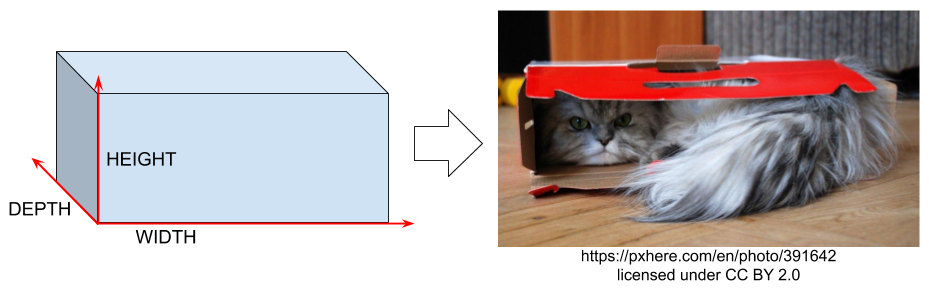
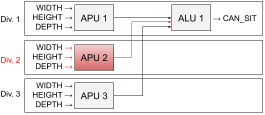

# HW-SW-builder

[](https://github.com/igor-buzhinsky/hw-sw-model-builder/actions/workflows/ci.yml)
[](./LICENSE)

## Introduction

HW-SW-builder is a tool for the formal verification of fault-tolerant systems that achieve fault tolerance by being separated into several redundant *divisions*. The components of the system need to be modeled for the [NuSMV](https://nusmv.fbk.eu) or [nuXmv](https://nuxmv.fbk.eu) model checkers. The tool is best suited for nuclear instrumentation and control (I&C) systems, as it supports fault injection to check *single fault tolerance*.

The tool is introduced in the following paper:

* [Buzhinsky I., Pakonen A. Model-checking detailed fault-tolerant nuclear power plant safety functions. IEEE Access, vol. 7, 2019, pp. 162139–162156. DOI: 10.1109/ACCESS.2019.2951938](https://ieeexplore.ieee.org/document/8892461/)

## Prerequisites

To run the tool, you need a Java Runtime Environment (JRE) 11 or newer. The tool is intended to work on Linux and Windows.

To (re)build the tool or to run its tests, you need a Java Development Kit (JDK) 11 or newer and [Apache Ant](https://ant.apache.org/).

To verify the formal models generated by the tool, you need [NuSMV](https://nusmv.fbk.eu) or [nuXmv](https://nuxmv.fbk.eu).

## Building and running

Pre-compiled JAR executables are provided: [hw_sw_builder.jar](./jars/hw_sw_builder.jar) and [comprehensive_verifier.jar](./jars/comprehensive_verifier.jar).

To (re)build them yourself, run the following from the root of the project:

```bash
ant
```

To see a short help message explaining how to run the tool, run:

```bash
java -jar jars/hw_sw_builder.jar
```

Below, we provide an example and explain how to run the tool on it.

## Testing

The tests check, among other things, that the NuSMV models and Prolog files generated for the bundled case studies remain identical to the reference files in [test/golden](./test/golden). To run the tests against classes compiled from the sources, run:

```bash
ant test
```

To run the same tests against the pre-built JARs in [jars](./jars) (this checks that the JARs are consistent with the sources), run:

```bash
ant test-jars
```

The test of `comprehensive_verifier.jar` additionally requires the C preprocessor (`cpp`) and [SWI-Prolog](https://www.swi-prolog.org/) (`swipl`; a different executable may be specified with `-Dhwswbuilder.prolog=<path>`) and is skipped if they are unavailable. NuSMV is not needed: the tests replace it with a script that records the models it is given.

If the output of the tool changes intentionally, regenerate the reference files with `ant test -Dhwswbuilder.updateGolden=true` and review the differences.

## Example

Since the original examples from the nuclear industry that we use are confidential, we provide a different, fictitious example that resembles the emergency core cooling (ECC) system but is simpler. In particular, no fault/validity signal processing is used here.

Consider the cognitive system of a cat deciding whether it can fit in a box, and if it fits, it sits. Assume that the cat assesses the width, height and depth of the box, compares them with fixed thresholds and decides to sit if all the comparisons pass. See the illustration below:



Due to the randomness of cats, a failure is possible within the cognitive system. The cognitive system is thus 3-redundant, with each division receiving possibly differing dimension measurements. Specifically, each Animal Perception Unit (APU) checks that the width is at least 200 mm, the height is at least 100 mm and the depth is at least 150 mm, and each Animal Locating Unit (ALU) collects comparison results from all the APUs and issues a sitting command if 2 out of 3 comparisons are successful. We assume that division 2 of this system has a failure and look at the output of division 1. See the architecture of this simplified model in the picture below:



The files describing this system are given below:

* [APU NuSMV model](./case_studies/cat_sitting/apu.smv)
* [ALU NuSMV model](./case_studies/cat_sitting/alu.smv)
* [File with auxiliary modules](./case_studies/cat_sitting/basic_blocks.smv) (just one module)
* [File with temporal requirements](./case_studies/cat_sitting/requirements.smv) (see the comments in the file for explanations of which requirements should be satisfied and which should not)
* [Configuration file](./case_studies/cat_sitting/cat_sitting.conf) (a failure in division 2 is assumed, and communication delays should be supplied from the command line; also see the description of the configuration language at the bottom of this README file)

The commands below are run from the [case_studies/cat_sitting](./case_studies/cat_sitting) directory (the script [cat-sitting.sh](./case_studies/cat_sitting/cat-sitting.sh) runs these steps one after another). To check the symmetry declarations specified in the configuration file, run:

```bash
java -jar ../../jars/hw_sw_builder.jar cat_sitting.conf --nusmvCommand "NuSMV" --configSubstitutions "DELAY_APU=0; DELAY_ALU=0" --checkSymmetry
```

Once the tool is run, its output will be written to [out.smv](./case_studies/cat_sitting/out.smv).

Now, assuming a single failure, we are going to check whether the sitting command is issued when all the measurements are acceptable, whether it can be issued spuriously, and whether the system can enter a deadlock-like state.

To verify the temporal requirements without communication delays, run:

```bash
java -ea -jar ../../jars/hw_sw_builder.jar cat_sitting.conf --nusmvCommand "NuSMV -coi -df -dynamic" --configSubstitutions "DELAY_APU=0; DELAY_ALU=0"
```

With BDD-based LTL model checking, the same run may not terminate within a reasonable time if delays are considered. We can use bounded model checking (BMC) to speed things up:

```bash
java -ea -jar ../../jars/hw_sw_builder.jar cat_sitting.conf --nusmvCommand "NuSMV -coi -df -dynamic -bmc -bmc_length 20" --configSubstitutions "DELAY_APU=2; DELAY_ALU=4"
```

## Configuration language

You can see an example of a configuration file for the tool [here](./case_studies/cat_sitting/cat_sitting.conf).

A configuration file consists of a number of *declarations*, each on its own line. Declarations are processed from top to bottom, and if a declaration refers to some other entity by name, that entity needs to be declared above it.

Empty lines are allowed. Single-line comments start with #.

Types of declarations:

* To specify settings: **settings** *basic_blocks_filename*={file with basic blocks used in units; the filename is given relative to the configuration file} *output_filename*={target file to write the generated formal model into; the filename is given relative to the configuration file} *vanishing_failures*={true or false; setting it to true enables correct verification of AG EF properties but increases the computational complexity of verification}
* To add a file with requirements to be checked for the generated models with NuSMV: **add_requirements** *filename*={NuSMV file with temporal requirements; the filename is given relative to the configuration file}
* To declare a unit group (a container of units that all have the same number of divisions; failures are specified per unit group): **unit_group** *name*={name, a string without spaces} *divisions*={number of divisions, a positive integer} *failing_division*={the index of the division with a failure, a positive integer not exceeding the total number of divisions; NA for no failure; or ALL for failures in all divisions}
* To declare an input of the overall model: **input** *in*={name of the unit group this input belongs to; the input has as many divisions as this unit group} *name*={name, a string without spaces} *nusmv_type*={NuSMV type without spaces, such as boolean, 0..10 or {1,3,7}}
* To declare an output of the overall model: **output** *in*={name of the unit group this output belongs to; the output has as many divisions as this unit group} *name*={name, a string without spaces}
* To declare a unit within a unit group: **unit** *in*={name of the unit group; this unit group must be declared above} *name*={name, a string without spaces} *filename*={NuSMV file with the definition of this unit as a single module; the filename is given relative to the configuration file} *nusmv_module_name*={NuSMV module name specified in this file} *max_delay*={maximum delay in cycles for all inputs of this unit, a non-negative integer; 0 means no delays} *nusmv_outputs*={;-separated list of module outputs (without separate _FAULT statuses) and their NuSMV types, each entry provided as name:type, no spaces allowed} *single_division_to_retain*={a positive integer to retain this unit only in this specific division, or NA to keep all its instances}
* To declare a symmetry with respect to input variables that can be checked automatically: **symmetry** *group*={unit group name} *unit*={unit name} *input_variable_indices*={comma-separated list of input variable indices (positive integers) such as 1,2,3; all indices must be different; _FAULT and _CONNECTED input variables are invisible here and will be considered together with their base variables during symmetry checks}
* To specify a single connection: **single_connection** *from*={source, see the clarification below} *to*={destination, see the clarification below}
* To specify a series of parallel connections, one for each division (the numbers of divisions in the source and the destination must match): **parallel_connection** *from*={source} *to*={destination}
* To specify cross-connections between all divisions of the source and all divisions of the destination: **all_to_all_connection** *from*={source} *to*={destination}

Additional notes regarding the *from* and *to* arguments of connections:

* inputs of the overall model are prefixed with "input."
* outputs of the overall model are prefixed with "output."
* integer and Boolean constants are allowed in "from" and must be prefixed with "const.", e.g. const.TRUE, const.FALSE, const.100, or const.-42
* units are referred to as {unit group name}.{unit name}
* in single connections, division indices are specified at the end after ".", e.g. {unit group name}.{unit name}.2 or input.{input name}.3

Finally, instead of a concrete value for an argument, a placeholder may be specified with the ${PLACEHOLDER_NAME} syntax, e.g. single_division_to_retain=${DIVISION_TO_RETAIN}. Such placeholders must be filled using the command line argument --configSubstitutions, e.g. --configSubstitutions "DIVISION_TO_RETAIN=1; SOME_OTHER_PLACEHOLDER=2"

## Automatic symmetry analysis, flexible failure criteria and a comprehensive case study

The structure of fault-tolerant redundant systems may lead to the symmetry of certain failure scenarios: e.g., it may be irrelevant which division of the system to verify or in which of the remaining divisions to assume a failure. Such situations can be identified automatically.

The tool [comprehensive_verifier.jar](./jars/comprehensive_verifier.jar) handles requirements that are prefixed with annotations written in the following format:

* [[REQ pattern={one of (1) ltl, (2) isolated, (3) ag_ef, depending on whether this is (1) an LTLSPEC or PSLSPEC to be verified with a failure criterion, (2) an LTLSPEC or PSLSPEC to be verified for one module with free inputs, (3) a CTLSPEC of the form AG EF some_non_temporal_formula} viewpoint={the *viewpoint* unit, whose outputs are checked in the property} single_failures={comma-separated list of unit groups where single failures should be permitted, without spaces} all_failures={comma-separated list of unit groups where common cause failures should be permitted, without spaces}]] LTLSPEC/PSLSPEC/CTLSPEC {actual requirement}
* The actual requirement may use the [[viewpoint_division]] macro, which is replaced with _DIV*N* during verification, where *N* is the division of the viewpoint unit chosen for model checking. Concrete divisions of units should not be referenced, except in cases that are invariant to division permutations, such as counting the number of signals that are on.

To see a short help message on command line arguments, run:

```bash
java -jar jars/comprehensive_verifier.jar
```

To use comprehensive_verifier.jar, you need to have [SWI-Prolog](https://www.swi-prolog.org/) and the C preprocessor (`cpp`, which is used to expand macros in requirement files) installed.

A full example of running the tool on a large case study is given in [case_studies/pas-comprehensive-separated.sh](./case_studies/pas-comprehensive-separated.sh) (Linux only; this script uses nuXmv):

```bash
cd case_studies
./pas-comprehensive-separated.sh
```

In particular, see the configuration file [case_studies/pas/ps_sas_pacs_pas.conf](./case_studies/pas/ps_sas_pacs_pas.conf) with placeholders to be specified with --configSubstitutions, and the requirement files in [case_studies/pas/reqs](./case_studies/pas/reqs). You will find verification logs in case_studies/pas/results_pas_comprehensive/. To see a summary of the logs, run:

```bash
./results.sh pas/results_pas_comprehensive/
```

## Related tools

You may also be interested in trying the following NuSMV-based tools for formal verification:

* [Tool to explain/visualize LTL counterexamples generated by NuSMV on the formula](https://github.com/igor-buzhinsky/nusmv_counterexample_visualizer)
* [Tool to explain/visualize LTL counterexamples generated by NuSMV on both the formula and the diagram of modules](https://github.com/ShakeAnApple/cxbacktracker)
